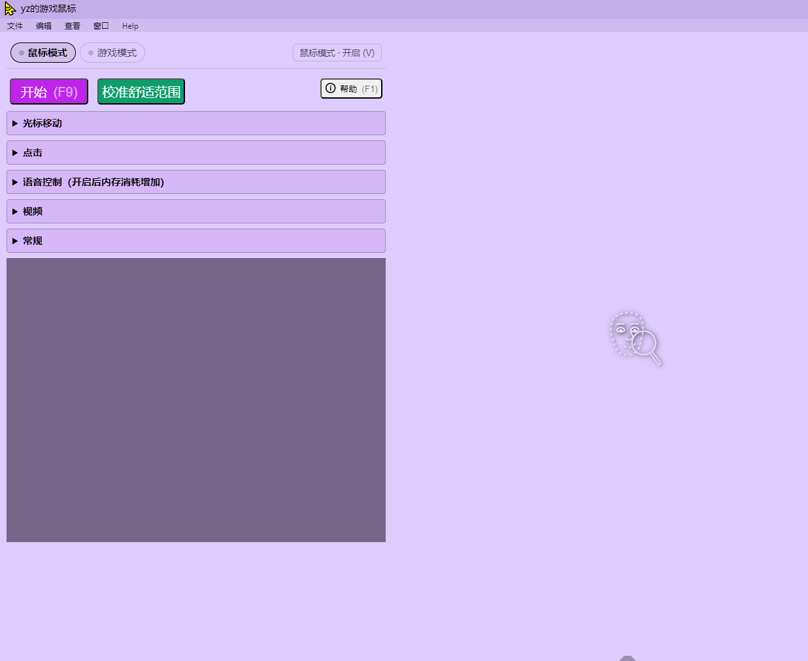
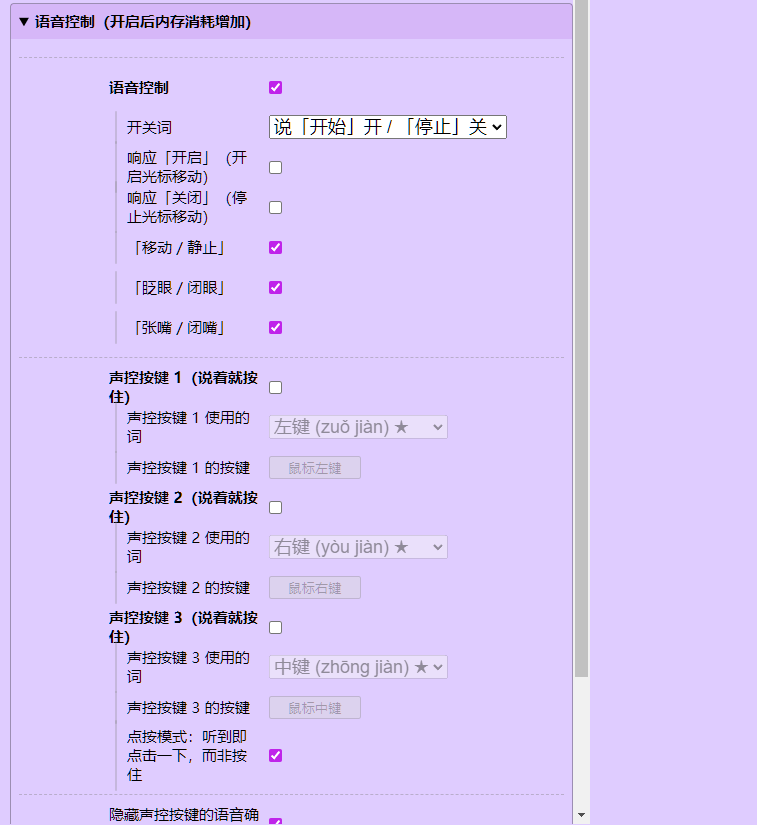

# yz的游戏鼠标

**基于开源项目 [Tracky Mouse](https://github.com/1j01/tracky-mouse) 改造的无手鼠标中文增强版** —— 头部移动控制光标 + 完全离线的中文语音控制。

> 根据开源项目 Tracky Mouse 进行改造 · 原项目作者 [Isaiah Odhner](https://github.com/1j01)，MIT 许可证。

<p align="center">
  
</p>

<p align="center">
  <sub>主界面：一个「开始」按钮加几个折叠面板，其余操作交给头部和声音</sub>
</p>

## 这是什么

在原版 Tracky Mouse 3.1.0（头部控制鼠标的免手操作软件）之上做的一系列改造，重点解决中文用户的使用体验：

- **中文语音控制**：说话即可开关光标移动、点击通道，识别**完全在本机离线**运行（内置约 5 MB 中文关键词模型，只监听你设置的词，听不懂也不会上传任何东西）；
- **声控按键**：说「左键 / 右键 / 中键」就按下对应鼠标键，持续发声＝持续按住，也可切换为「点按模式」（听到即点一下）；
- **一系列易用性修复**：舒适范围校准、光标限速、静止自动回中、离合器「隐形墙」修复等。

不改动官方安装包本身，而是以**文件补丁**方式安装（自动备份原文件，可用卸载脚本一键还原）。

## 功能一览

| 类别   | 功能                          | 说明                                  |
| ---- | --------------------------- | ----------------------------------- |
| 语音控制 | 开关光标移动                      | 三组词任选：开启/关闭、开始/停止、打开/关闭             |
| 语音控制 | 「移动 / 静止」「眨眼 / 闭眼」「张嘴 / 闭嘴」 | 分别控制移动、眨眼点击、张嘴点击，互不影响               |
| 语音控制 | 「开始」「停止」可单独静音               | 「开始」在日常说话中太常见，可单独关掉识别               |
| 声控按键 | 左键 / 右键 / 中键                | 双音节词，实测 180/180 命中；支持 hold 与点按两种模式  |
| 声控按键 | 自定义词                        | 可换成 前/后/上/下/点                       |
| 校准   | 舒适范围四方向校准                   | 转头到舒服的极限，让同样动作正好够到屏幕角落              |
| 校准   | 张嘴确认 + 10 秒验证门              | 校准失败自动恢复，不会「调完反而没法用」                |
| 光标   | 最大速度限制                      | 提高灵敏度的同时压住头部抖动                      |
| 光标   | 静止自动回中                      | 几秒不动就滑回屏幕中心，清除长期漂移                  |
| 修复   | 离合器「隐形墙」                    | 开启时光标位置不再影响可达范围，中心点始终在正中            |
| 其他   | 手柄摇杆、点按模式、语音回执感叹号           | 详见 [docs/补丁完整说明.md](docs/补丁完整说明.md) |

<p align="center">
  
</p>

<p align="center">
  <sub>设置 → 语音控制：开关词、三路声控按键、点按模式，每一项都能单独关掉</sub>
</p>

## 语音指令速查

| 你说                     | 效果                   | 默认        |
| ---------------------- | -------------------- | --------- |
| 开启 / 关闭（或 开始/停止、打开/关闭） | 光标移动开 / 关            | ✅ 开       |
| 移动 / 静止                | 光标移动开 / 关（「静止」不影响点击） | ✅ 开       |
| 眨眼 / 闭眼                | 眨眼点击开 / 关            | ✅ 开       |
| 张嘴 / 闭嘴                | 张嘴点击开 / 关            | ✅ 开       |
| 左键 / 右键 / 中键           | 按下对应鼠标键（持续发声＝持续按住）   | ⬜ 需在设置中开启 |

> 所有词都可以在 **设置 → 语音控制** 里更换、单独开关。识别离线进行，麦克风只用于本地识别。

## 安装

1. 先安装官方 **Tracky Mouse 3.1.0**：从 [trackymouse.js.org](https://trackymouse.js.org/) 或 [原项目 Releases](https://github.com/1j01/tracky-mouse/releases) 下载安装；
2. 下载本仓库 **Releases** 页的 zip（或直接 `Code → Download ZIP`），解压；
3. 进入 `tracky-clutch` 目录，右键运行（或 PowerShell 执行）：
   ```
   powershell -ExecutionPolicy Bypass -File install\install.ps1
   ```
   如提示软件正在运行，加 `-ForceStop` 参数；
4. 启动 Tracky Mouse，设置 → 语音控制 → 勾选「语音控制」即可开始使用。

**卸载**：运行 `install\uninstall.ps1`，所有原版文件自动还原。

**注意**：官方软件自动更新会覆盖补丁文件，更新后需重新运行一次安装脚本。

## 系统要求

- Windows 10/11（需摄像头与麦克风）
- 如需 3D 游戏视角控制，另装 [ViGEmBus 驱动](https://github.com/nefarius/ViGEmBus/releases)（ViGEmClient.dll 已随补丁附带）
- 开启语音控制后内存增加约 150–190 MB（本地模型开销，属正常现象）

## 目录结构

```
├── install/            # 安装 / 卸载脚本（PowerShell）
├── patch/              # 补丁文件（按原目录结构覆盖到官方安装目录）
│   └── resources/app/...
├── changes.diff        # 与官方 3.1.0 的完整代码差异
└── docs/
    └── 补丁完整说明.md  # 每个版本的详细改动与排查记录
```

## 常见问题

- **语音识别不到 / 不灵**：说话前留约 0.3 秒以上安静停顿；单音节词不够稳，按键词请用双音节默认词（左键/右键/中键）。
- **光标到不了屏幕上下边缘 / 中心点不在正中**：升级到 v50（含 50.1 修正）即可，详见完整说明的 v50 章节。
- **打不开 / 白屏**：确认按官方 3.1.0 安装后再打补丁；若装的是旧版补丁，重新运行安装脚本覆盖。

## 许可证与致谢

- 本仓库的修改部分遵循与原项目相同的 **MIT 许可证**，见 [LICENSE.txt](LICENSE.txt)；
- 原项目 [Tracky Mouse](https://github.com/1j01/tracky-mouse) © Isaiah Odhner，MIT License；
- 关键词识别基于 [sherpa-onnx](https://github.com/k2-fsa/sherpa-onnx)（Apache License 2.0）及随附的中文关键词模型；
- [ViGEmClient](https://github.com/nefarius/ViGEm) 许可证见 `patch/resources/bin/licenses/ViGEmClient-LICENSE.txt`；
- 改造人：yz（[B 站主页](https://space.bilibili.com/3546589207463973)）
